<div align="center">


# 深圳漫游 · BAYWALK

### 在浏览器里 1 : 1 走进真实的深圳湾与人才公园

**零游戏引擎 · 单一运行时依赖 (`three`) · 3.0 公里真实地理半径 · 4,286 栋实测建筑 · 124 根实地采集星光柱**

<p>
  <a href="README.md"><strong>简体中文</strong></a> ·
  <a href="README_EN.md">English</a>
</p>

<p>
  
  
  
  
  
  
  
</p>

<p>
  <a href="#-快速开始docker-一键部署">🐳 Docker 一键部署</a> •
  <a href="#-实拍-vs-实机还原度对照">📸 实拍 vs 实机对照</a> •
  <a href="#-核心特性与视觉展示">✨ 核心特性</a> •
  <a href="#-直达机位与深链传送门">🧭 机位传送门</a> •
  <a href="#-技术架构与多源地理数据管线">🏗️ 技术架构</a> •
  <a href="#-数据来源与致谢">📄 数据与许可</a>
</p>

<br />

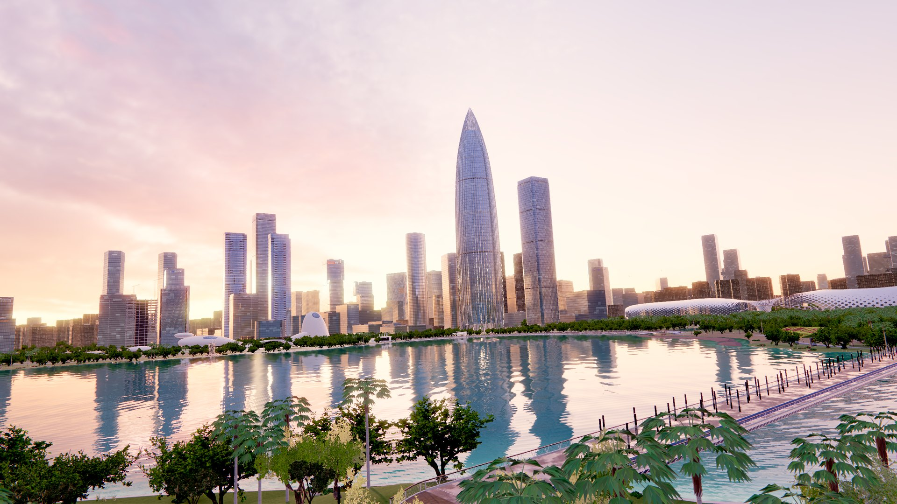

<sub><em>从人才星光桥隔湖眺望中国华润大厦「春笋」、深圳湾文化广场与深圳湾体育中心「春茧」——浏览器 WebGL 2 实时渲染画面</em></sub>

</div>

---

## 🌟 为什么与众不同？

不同于常见的「AI 提示词随机生成方块城市」，**深圳漫游 · BAYWALK** 是一次面向真实世界的 **1 : 1 浏览器端城市数字重建实验**：

- **🌍 真地理，而非随机程序化积木**：以人才公园内湖（`22.51366° N, 113.94417° E`）为原点，按 WGS84 局部米制投影完整还原 **半径 3.0 公里（28.27 km²）** 的真实深圳湾、后海总部基地、海岸城与南山科技轴。
- **🛰️ 科研级多源空间数据融合**：融合 **OpenStreetMap** 路网与建筑轮廓、*Nature Scientific Data (2025)* **CMAB 中国建筑高度数据集**、**Copernicus Sentinel-2C** 真彩色卫星正射底图、**Meta & WRI CHMv2 (2026)** 高分辨率树冠高度栅格，以及 **AWS Terrain Tiles** 22 公里外延群山高程。
- **📷 实地走街采集 + 逐像素视觉对齐**：实地走遍人才公园采集 **124 根双面星光柱**（桥面 65 根 + 南岸 59 根）并按照片 EXIF 经纬度逐根校准；潮汐广场、花草字、青铜群像、深圳鹏程第二代比亚迪 e6 出租车与 2024 款特斯拉 Model 3 焕新版均提供**同机位实拍 vs 实机分屏对比器**。
- **⚡ 极致轻量的纯前端架构**：没有 200MB 的游戏引擎 WASM 运行时，**`package.json` 生产依赖仅有 `three@0.182.0` 一个包**。100 个原生 ES 模块（20,781 行代码），Vite 构建仅需 1.85 秒，JS 核心包 Gzip 后仅 ~510 KB，桌面端与移动端触屏开箱即玩。

<div align="center">

| 地理尺度 | 实测建筑 | 实测路网 | 树冠植被 | 实地采集星光柱 | 生产运行时依赖 |
| :---: | :---: | :---: | :---: | :---: | :---: |
| **1 : 1** · 3.0 km 半径 | **4,286** 栋 | **6,084** 条路段 | **9,000** 棵<br><sub>(采自 14,129 树冠峰)</sub> | **124** 根<br><sub>(含 EXIF 精校与文献导览)</sub> | **仅 1 个**<br><sub>(`three@0.182.0`)</sub> |

</div>

---

## 📸 实拍 vs 实机：还原度对照

项目内置可拖动分隔线的 **实机画面对照页 (`/comparison/index.html`)**，支持 2560 × 1440 原始画幅局部放大校验与同机位对比：

<table>
  <tr>
    <td width="50%" align="center">
      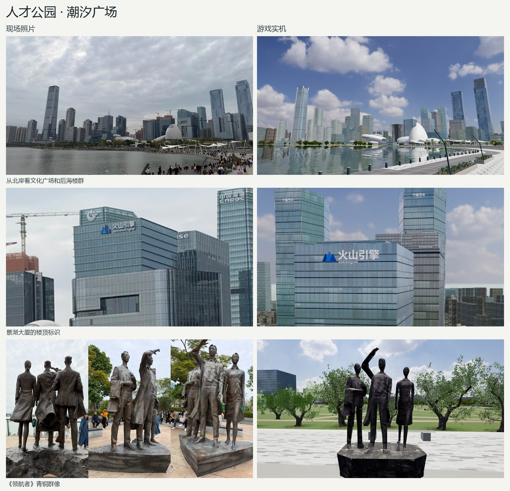
      <br />
      <strong>潮汐广场 · 火山引擎/中海油天际线 · 《领航者》青铜像</strong>
      <br />
      <sub>左侧为现场实拍，右侧为浏览器 WebGL 2 实时渲染同机位画面</sub>
    </td>
    <td width="50%" align="center">
      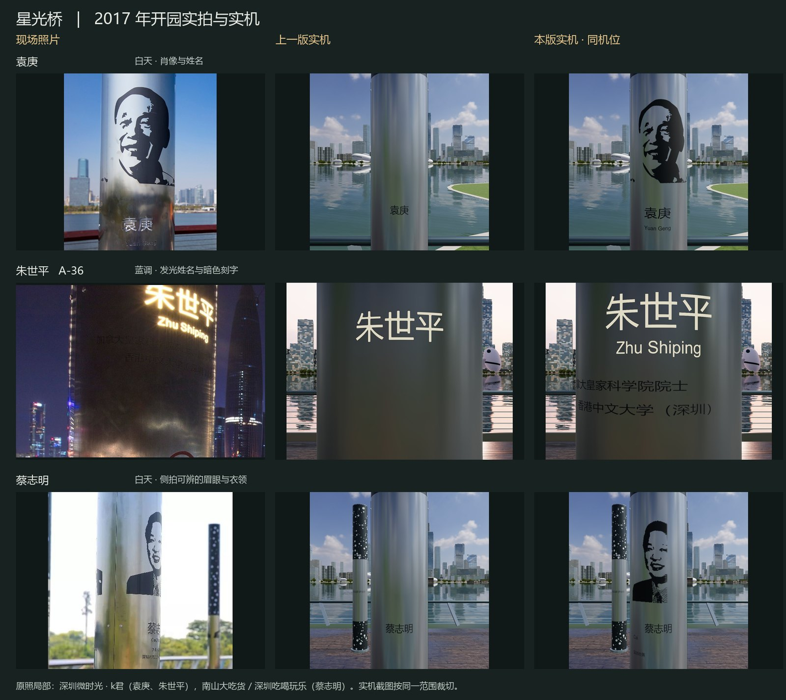
      <br />
      <strong>人才星光桥 · 袁庚 / 朱世平 / 蔡志明 实拍校准</strong>
      <br />
      <sub>金属柱面弧面展开刻像、暗色职衔刻字与柱身夜光逐一比对现场原照</sub>
    </td>
  </tr>
</table>

---

## ✨ 核心特性与视觉展示

### 1. 全天候天际线灯光秀 × 四季四态气象系统
- **4 种时段**：午后、日落、蓝调时刻、夜晚（支持夜空月亮独立开关）
- **4 × 4 四季与气象**：春夏秋冬 × 晴朗 / 阵雨 / 降雪 / 极光夜
- **真实物理细节**：降雪模式下**人才公园内湖自动结冰，而外海深圳湾依然保留动态波浪**；夜晚开启**全城联动灯光秀**，春笋保持标志性金色翼柱，周边摩天楼幕墙同步流转蓝青与紫红光带，并通过 Three.js `Reflector` 实时倒映湖面。

<table>
  <tr>
    <td width="50%" align="center">
      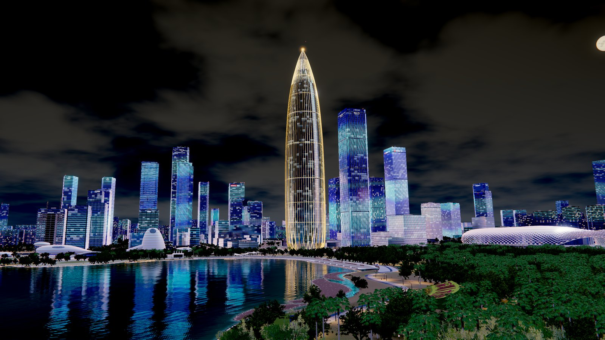
      <sub><strong>全城联动灯光秀</strong> — 统一节目时钟同步全城楼宇灯带与实时湖面倒影</sub>
    </td>
    <td width="50%" align="center">
      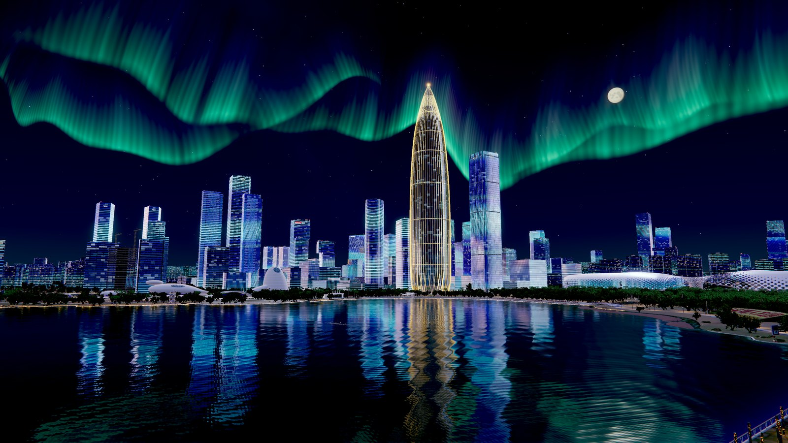
      <sub><strong>深圳湾极光夜</strong> — GLSL 实时大气与极光着色器叠加城市夜景</sub>
    </td>
  </tr>
  <tr>
    <td width="50%" align="center">
      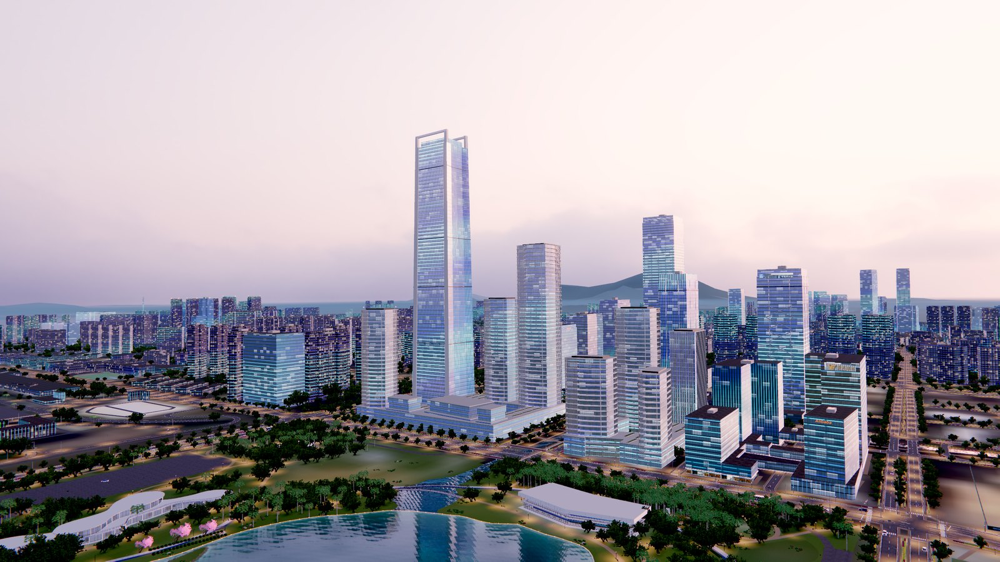
      <sub><strong>深圳湾一号 · 蓝调时刻</strong> — T7 临湖真实立面透视校正 + 潮汐广场</sub>
    </td>
    <td width="50%" align="center">
      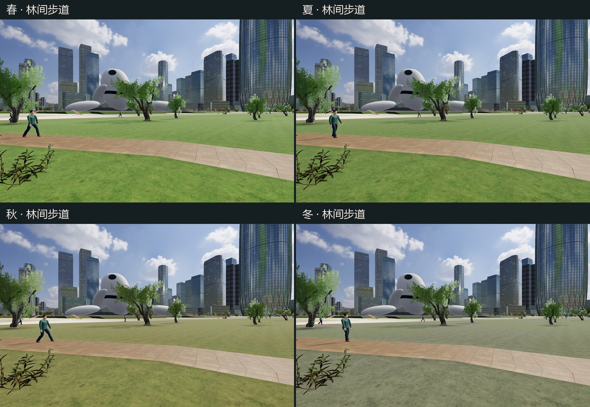
      <sub><strong>人才公园四季演化</strong> — 春夏秋冬植被色相、地被与光影实时过渡</sub>
    </td>
  </tr>
</table>

### 2. 1 : 1 地标建筑群精雕还原
涵盖后海与南山核心地标：**中国华润大厦「春笋」**、**深圳湾体育中心「春茧」**（含场内球场与海之门透明屏）、**深圳湾文化广场**（MAD 9 座自然白花岗岩石壳展馆）、**腾讯滨海大厦**（南塔 245.78m / 北塔 194.75m / 三道空中连廊 / 西广场双语字座与篮球场）、**深圳湾一号**、**海岸城二层步行街与文心四路桥下**、**后海大桥**、**南北观海栈桥**、**远景深圳湾公路大桥**，以及人才公园内的 **π 桥（刻有圆周率小数点后 2017 位）**、**双曲桥**、**求贤阁**、**群英荟**、**风帆塔**、**花草字**与多组实景雕塑。

<table>
  <tr>
    <td width="50%" align="center">
      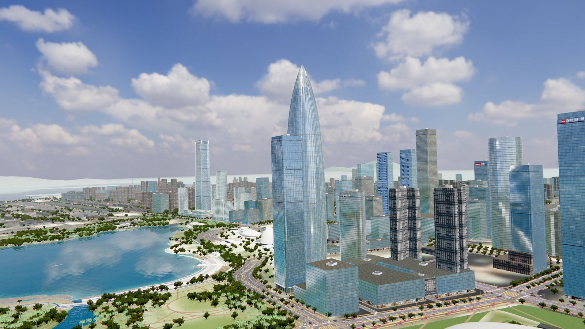
      <sub><strong>春笋与后海总部基地</strong> — KPF 外框收分几何与真实建筑群高空俯瞰</sub>
    </td>
    <td width="50%" align="center">
      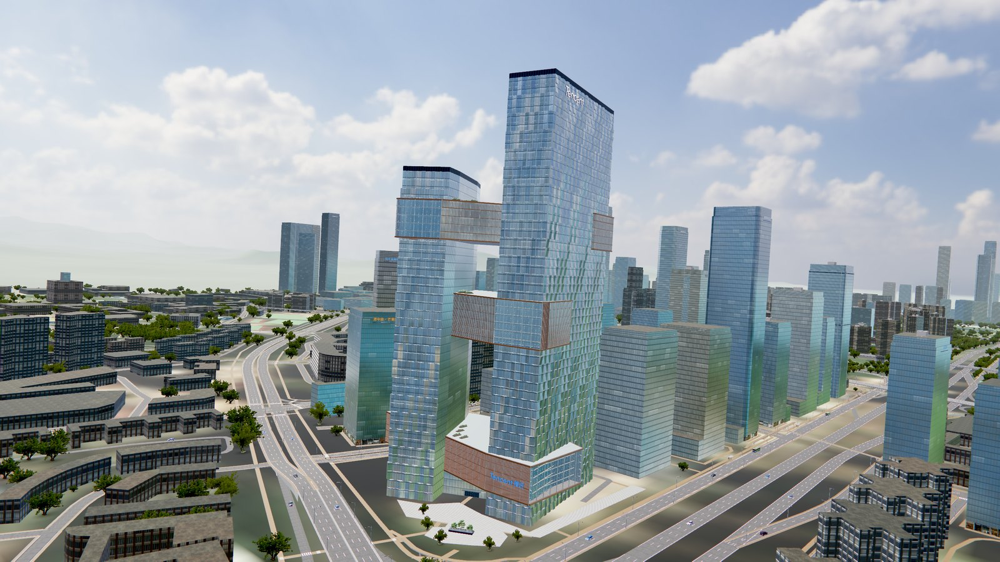
      <sub><strong>腾讯滨海大厦</strong> — 按结构/幕墙论文米制建模，含 0.9m 外挑单元与三层连廊</sub>
    </td>
  </tr>
</table>

### 3. 真实深圳街头生态与交互式车辆图鉴
- **深圳巴士集团鹏程第二代比亚迪 e6 出租车**：严格对照原厂 4,695 × 1,810 × 1,670 mm 尺寸、经典蓝白涂装与 `95128` 机身字样，附可编辑原生 Blender 工程。
- **2024 Tesla Model 3 焕新版**：悬挂虚构深圳新能源绿牌 **`粤B·D03726`**，支持湿润街面局部实时反射与独立**车辆图鉴展示间（Garage Configurator）**。
- **动态城市呼吸**：多车型仿真车流（SUV / MPV / 轿车 / 两厢车 / 深圳公交）、真实红绿灯与抓拍杆相位联动、带自定义步态的行人 NPC、环境音系统。

<table>
  <tr>
    <td width="50%" align="center">
      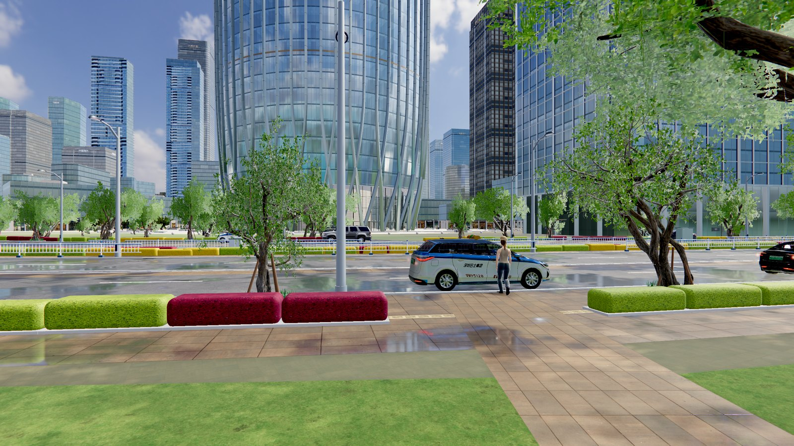
      <sub><strong>登良路街头实景</strong> — 深圳蓝白 e6 出租车、真实湿润地面反射与动态行人</sub>
    </td>
    <td width="50%" align="center">
      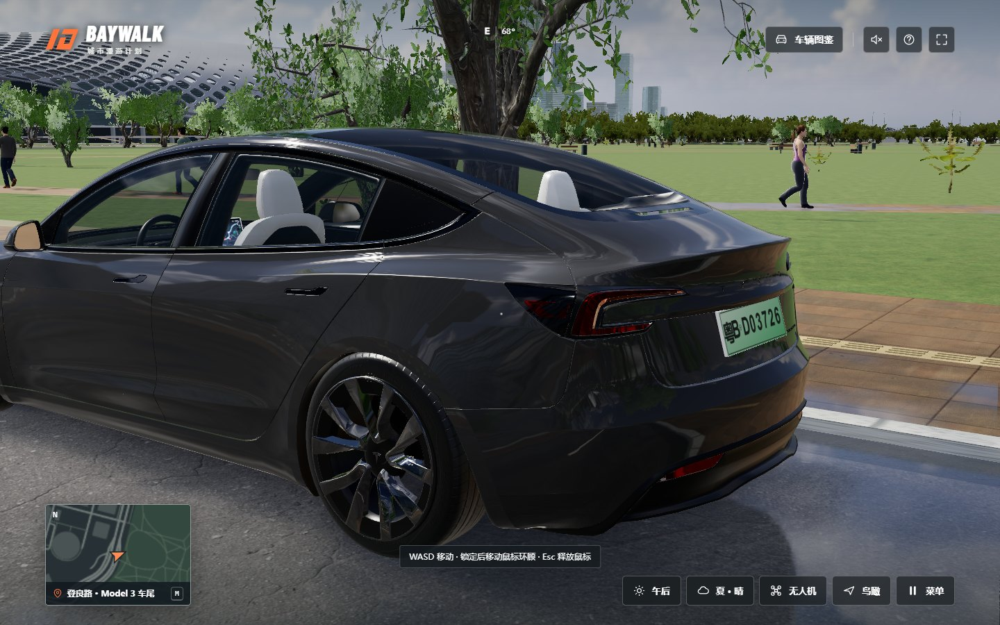
      <sub><strong>2024 Model 3 焕新版</strong> — 粤B·D03726 绿牌、分件轮毂与实时环境反射</sub>
    </td>
  </tr>
</table>

### 4. 四重视角 × 电影级自动无人机巡航
内置 **第一人称步行 / 鸟瞰 / 自由无人机 (`F`) / 自动无人机航拍巡航 (`G`)** 四种模式。自动巡航内置三条基于 Catmull-Rom 样条曲线的电影级运镜路线（**深圳湾全景巡航**、**人才湖灯光秀环游**、**南山科技天际线**），支持 0.5×–2.0× 变速、进度条拖拽、**随时一键接管飞行**以及 `H` 键纯净无 UI 模式（专为录屏与壁纸打造）。

<div align="center">
  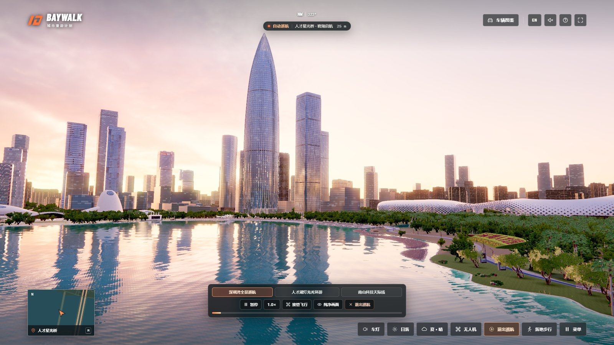
  <br />
  <sub><strong>自动无人机巡航模式</strong> — 三条预设航线、实时高度/指南针/小地图 HUD、一键接管与纯净画面</sub>
</div>

---

## 🐳 快速开始（Docker 一键部署）

本项目内置多阶段生产级 `Dockerfile` 与针对 WebGL 2 / `.glb` / 大体积 GIS JSON 深度调优的 Nginx 配置（自动开启 Gzip 压缩、1 年强缓存指纹资源、健康检查 `/healthz`）。

### 方式一：Docker Compose（推荐，一条命令上线）

```bash
# 1. 克隆仓库
git clone https://github.com/DeaglePC/shenzhen-baywalk.git
cd shenzhen-baywalk

# 2. 一键构建并后台启动（默认监听 8080 端口）
docker compose up -d --build
```

启动后在支持 WebGL 2 的现代浏览器（Chrome / Edge / Safari / Firefox）打开：
👉 **http://localhost:8080**

> **自定义端口**：复制 `.env.example` 为 `.env`，修改 `BAYWALK_PORT=3000`，或直接执行：
> ```bash
> BAYWALK_PORT=3000 docker compose up -d --build
> ```
>
> **容器内热更新开发模式**（无需本机安装 Node.js）：
> ```bash
> docker compose --profile dev up baywalk-dev
> # 访问 http://localhost:5192
> ```

### 方式二：原生 Docker CLI

```bash
docker build -t shenzhen-baywalk:latest .
docker run -d --name shenzhen-baywalk -p 8080:80 --restart unless-stopped shenzhen-baywalk:latest
```

### 方式三：本地 Node.js 运行（或 Windows 一键启动）

- **环境要求**：Node.js `>= 20`（推荐 `22 LTS`），浏览器需支持 **WebGL 2**。
- **Windows 快速启动**：直接双击根目录的 **`启动漫游.cmd`**，等待浏览器自动打开后点击「开始漫游」。
- **命令行启动**：

```bash
npm install
npm run dev -- --open      # 本地开发（默认端口 5192）

npm run build              # 构建生产包到 dist/
npm run preview -- --open  # 本机预览生产包
```

---

## 🧭 直达机位与深链传送门

支持通过 URL 查询参数直达任意经典机位、航拍路线、天气组合或图鉴界面，非常适合分享特定打卡点：

| 场景主题 | 直达路径（拼接在站点域名后） | 亮点说明 |
| :--- | :--- | :--- |
| 🚁 **深圳湾全景自动巡航** | `/?tour=bay-grand` | 72 秒电影级全自动航拍，串联星光桥、春茧、春笋、深圳湾一号与 π 桥 |
| 🎆 **人才湖灯光秀环游** | `/?tour=lake-lightshow` | 夜景模式全城联动灯光秀自动环湖航拍 |
| 🏙️ **南山科技天际线** | `/?tour=tech-skyline` | 从腾讯滨海大厦起飞，穿越海岸城、后海总部与科苑南路 |
| 🌌 **星光桥 · 极光冬雪夜** | `/?walk=bridge&weather=aurora&season=winter` | 极光漫天 + 冰封内湖 + 星光柱亮灯 |
| ❄️ **π 桥 · 降雪冰湖** | `/?walk=pi&weather=snow` | 2,017 位圆周率栏杆 + 冬季内湖结冰与海湾波浪对比 |
| 🏢 **腾讯滨海大厦航拍** | `/?walk=tencent` | 双塔三连廊与 0.9 米外挑幕墙空中全景 |
| 🏀 **腾讯西广场 / 海天二路** | `/?walk=tencent-entry&period=day` · `/?walk=haitian-road&period=day` | 步行至「Tencent 腾讯」石座、东门与街边篮球场 |
| 🏟️ **航拍春茧 / 场内草坪** | `/?walk=stadium&camera=drone` · `/?walk=field` | 俯瞰镂空网壳或直入体育场内场跑道 |
| 🚕 **登良路 · 深圳出租车** | `/?walk=street&photo=1` | 与实车照片同机位近看比亚迪 e6 蓝白出租车 |
| 🚗 **Model 3 街头 / 车辆图鉴** | `/?walk=model3` · `/?inspect=model3&view=REAR_DETAIL` | 近距离观赏粤B绿牌焕新版 Model 3 或进入摄影棚车库 |
| 🌉 **海岸城双层 / 后海大桥** | `/?walk=coast-walk` · `/?walk=wenxin-road` · `/?walk=houhai-bridge&camera=drone&period=day` | 穿梭海岸城二层连廊与文心四路桥下，或俯瞰沙河西路双幅桥面 |
| 🎓 **星光桥人物索引** | `/?inspect=talent` | 浏览全部实地采集与文献考据的深圳人才名录 |
| 🔍 **实拍 vs 实机分屏对比** | `/comparison/index.html` | 拖动分隔线逐像素对比 2560×1440 实机画面与现场实拍 |

<details>
<summary><strong>🎮 完整操作指南与快捷键（点击展开）</strong></summary>

| 模式 / 功能 | 桌面端操作 | 移动端触屏操作 |
| :--- | :--- | :--- |
| **步行 / 快步** | `W A S D` 或方向键，按住 `Shift` 加速 | 左侧虚拟摇杆拖动 |
| **环顾视角** | 单击画面或「单击锁定鼠标」进入连续转身，`Esc` 释放；菜单支持 25%–300% 灵敏度调节 | 屏幕空白处拖动转向 |
| **区域地图传送** | 按 `M` 打开交互式地图，选择预设地标或点击任意街道传送 | 点击左下角小地图 |
| **鸟瞰环绕** | 按 `V` 切换：左键环绕、右键平移、滚轮缩放 | 工具栏切换鸟瞰按钮 |
| **自由无人机** | 按 `F` 起降：`WASD` 水平移动、`Space` 上升、`Ctrl` 下降（随离地高度自动提速，按住 `Shift` 再翻倍） | 摇杆 + 屏幕右侧「升 / 降」按键 |
| **自动无人机巡航** | 按 `G` 启停，支持切换 3 条路线、调速、进度拖拽与一键接管 | 工具栏「自动巡航」按钮 |
| **气象 / 时段 / 车灯** | 底部工具栏切换时段（日落/午后/蓝调/夜晚）、四季与天气；按 `L` 开关汽车车灯 | 底部工具栏点击切换 |
| **纯净录屏模式** | 按 `H` 隐藏/恢复全部 HUD 界面 | 巡航栏「纯净画面」按钮 |

</details>

---

## 🏗️ 技术架构与多源地理数据管线

```mermaid
flowchart LR
    subgraph Sources["多源真实世界数据"]
        OSM["OpenStreetMap\n路网 / 建筑 / 水系"]
        CMAB["CMAB (Nature 2025)\n中国建筑高度融合"]
        SAT["Sentinel-2C (2025)\n10m 真彩色正射影像"]
        CHM["Meta & WRI CHMv2\n14,129 真实树冠"]
        DEM["AWS Terrain Tiles\n22km 外延山体高程"]
        FIELD["实地采集 (EXIF)\n124 根星光柱 / 实车 / 雕塑"]
    end

    subgraph Pipeline["离线资产与自动化视觉质检 (36 Python Scripts)"]
        GIS["geodata.py / geoheight.py\ngeocanopy.py / geobay.py"]
        BLENDER["Blender 自动化导出\nModel 3 / e6 / 车流 / 青铜雕塑"]
        QA["qa_daemon.py / qa_probe.py\n同机位视觉回归校验"]
    end

    subgraph Engine["浏览器端实时渲染引擎 (100 ES Modules · Pure Three.js)"]
        WORLD["world.js / city.js\nWGS84 米制场景调度"]
        LANDMARKS["地标精建模块\n春笋 / 春茧 / 腾讯双塔 / 文化广场"]
        ENV["GLSL 大气 / 四季气象\nReflector 实时倒影 / 全城灯光秀"]
        LIFE["智能车流 / 信号灯相位\nNPC 步态 / 四重相机与自动巡航"]
    end

    subgraph Deploy["生产交付"]
        VITE["Vite 7 构建 (~510KB gzip)"]
        DOCKER["Docker + Nginx Alpine\nGzip / 强缓存 / /healthz"]
    end

    Sources --> Pipeline --> Engine --> VITE --> DOCKER
```

<details>
<summary><strong>📂 项目目录结构总览（点击展开）</strong></summary>

```text
shenzhen-bay/
├── Dockerfile                # 多阶段生产构建 (Node 22 -> Nginx 1.27 Alpine)
├── docker-compose.yml        # 一键生产部署 & 可选 dev 热更新 Profile
├── docker/nginx.conf         # 针对 WebGL 2 / .glb / GIS JSON 调优的 Nginx 配置
├── index.html                # 主入口与全套交互 HUD
├── vite.config.js            # Vite 7 预构建与依赖优化配置
├── src/                      # 100 个纯原生 ES 模块（20,781 行代码）
│   ├── app.js                # 路由、深链、HUD 状态机与主控入口
│   ├── world.js              # 三维世界装配、碰撞检测与物理循环
│   ├── city-*.js             # 春笋、春茧、文化广场、星光桥、全城灯光秀、自然地貌
│   ├── tencent-*.js          # 腾讯滨海大厦双塔、三连廊与西广场街区
│   ├── park-*.js             # 人才公园桥梁、建筑、雕塑、花草字、亮化与细部
│   ├── talent-*.js           # 124 根实地采集星光柱、肖像贴图与文献导览器
│   ├── weather*.js           # 四季四态气象、湖面结冰、极光与大气 GLSL 着色器
│   ├── vehicles.js / garage.js # 车流 AI、信号灯联动、Model 3 与 e6 车辆图鉴
│   ├── drone-tour.js         # Catmull-Rom 自动无人机航拍巡航系统
│   └── i18n.js               # 完整中英双语国际化
├── public/                   # 静态 3D 资产与地理数据集
│   ├── data/                 # shenzhen.json (4,286 建筑 / 6,084 道路)、卫星与树冠数据
│   ├── models/               # 车辆 GLB (Model 3、鹏程 e6、四款车流) 与 HDR 摄影棚
│   ├── city/                 # 雕塑 GLB、建筑立面与花草字纹理
│   ├── talent/               # 124 根星光柱实地采集贴图与考据资料
│   ├── comparison/           # 实拍 vs 实机交互式分屏对比页与原图
│   └── credits.html          # 完整素材与开源许可声明页
├── models/                   # 可编辑原生 Blender 工程（鹏程 e6 / Model 3 焕新版）
├── scripts/                  # 36 个 Python GIS 管线、Blender 批处理与视觉 QA 回归脚本
└── docs/images/              # README 展示图集
```

</details>

---

## 🔬 自动化视觉回归与开发工具

项目不仅关注构建，还配备了一套面向 3D 城市场景的自动化视觉质检（Visual QA）工具链，用于同机位校验路沿接缝、信号灯杆位、车辆高光与草坡断层：

```bash
# 启动常驻视觉质检守护进程
npm run qa:daemon

# 运行单次无头探针截图与状态校验
npm run qa:probe
```

如需从原生 Blender 工程重新导出四款车流模型，可依次运行：

```bash
python scripts/traffic_art.py <缓存目录>
blender -b -P scripts/traffic_import.py -- <缓存目录>
```

---

## 📄 数据来源与致谢

本项目严格遵循各类开源地理数据与三维资产的署名要求，详细出处与许可证请查阅以下文档：

- **地理与遥感数据**：© [OpenStreetMap contributors](https://www.openstreetmap.org/copyright) (ODbL 1.0) · [CMAB Building Dataset](https://doi.org/10.1038/s41597-025-04730-5) (CC BY 4.0) · Copernicus Sentinel-2C (2025) · [Meta & WRI CHMv2](https://registry.opendata.aws/dataforgood-fb-forestsv2/) (CC BY 4.0) · [AWS Terrain Tiles](https://registry.opendata.aws/terrain-tiles/) — 详见 [地理数据说明](public/data/SOURCES.md)
- **建筑、车辆与材质资产**：[Poly Haven](https://polyhaven.com/) (CC0) · [ambientCG](https://ambientcg.com/) (CC0) · 2024 Tesla Model 3 & Generic Passenger Car Pack (CC BY 4.0) — 详见 [城市场景说明](public/city/SOURCES.md) · [植被来源](public/foliage/SOURCES.md)
- **星光桥人物肖像与文献**：详见 [星光桥资料与授权](public/talent/SOURCES.md) 与 [完整素材声明页](public/credits.html)

---

<div align="center">

**如果你喜欢这座在浏览器里点亮的深圳湾，欢迎点亮右上角的 ⭐ Star！**

*Made with Three.js, real-world GIS data, and a long walk across Shenzhen Talent Park.*

</div>
