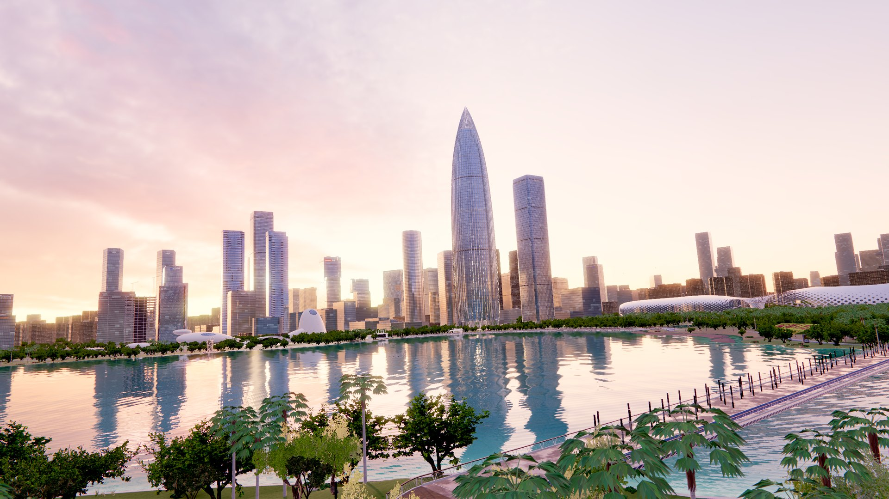
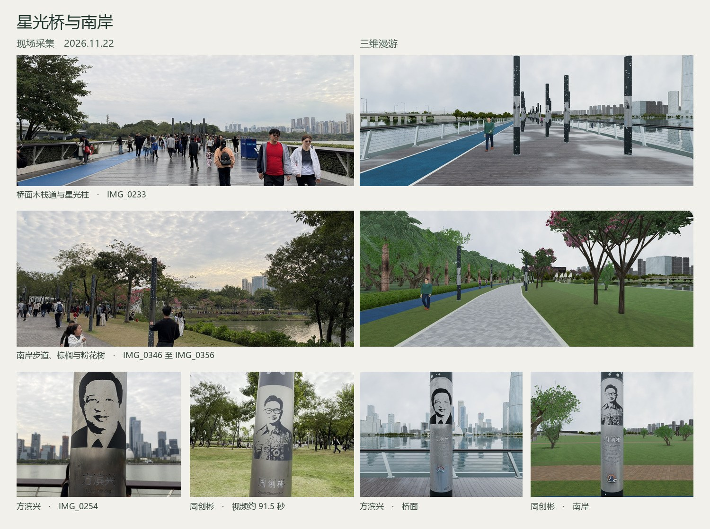
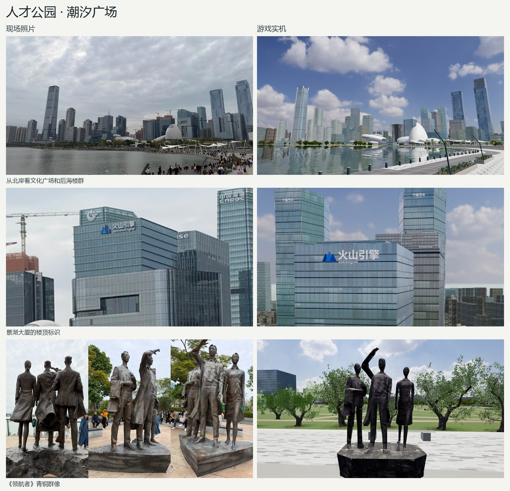
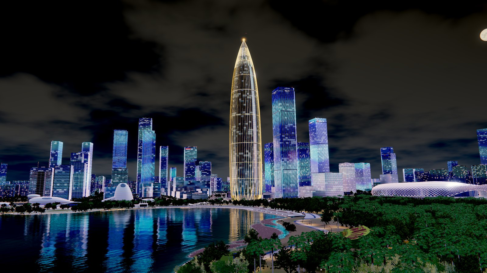
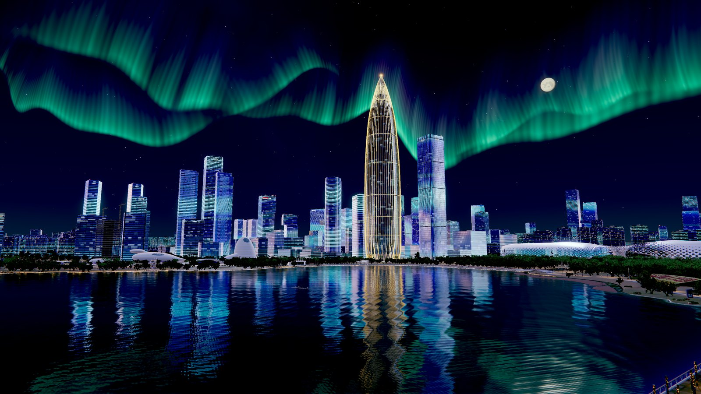
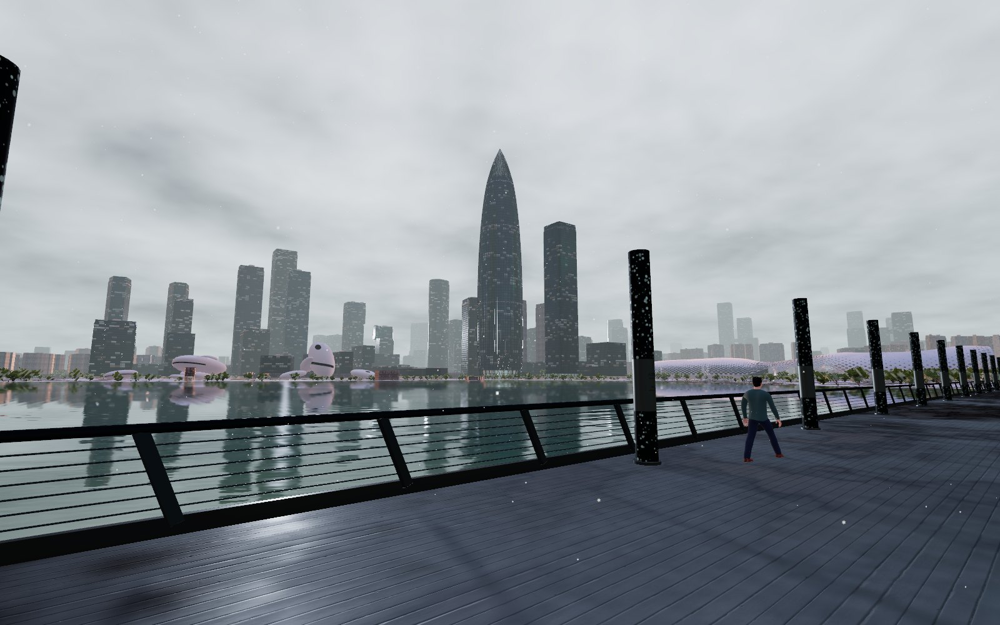
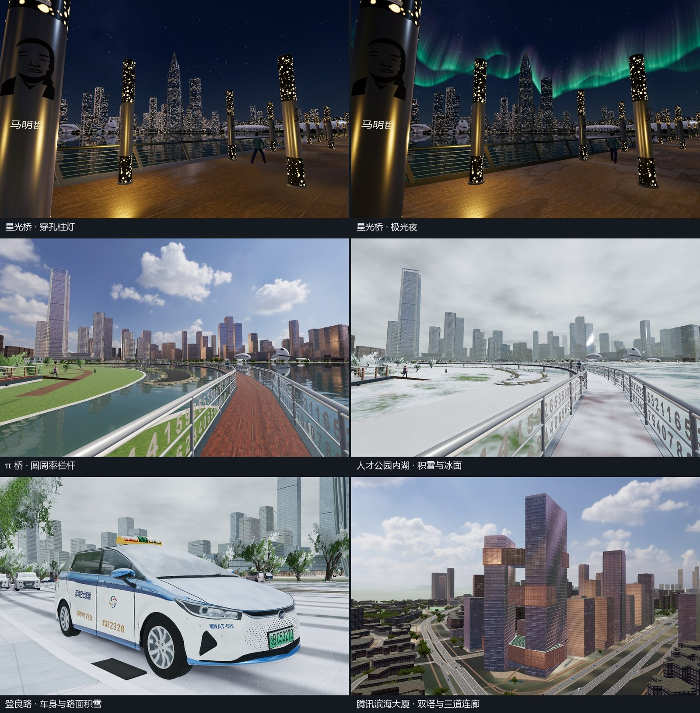
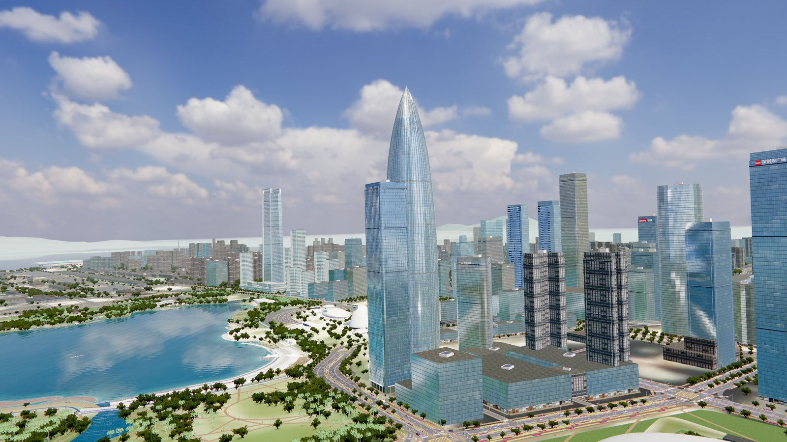
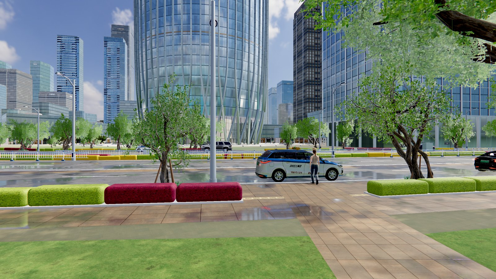
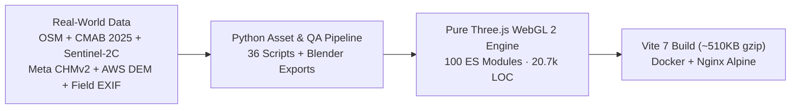

<div align="center">


# SHENZHEN BAYWALK · 深圳漫游

### A 1 : 1 Real-World 3D Open-World Recreation of Shenzhen Bay & Talent Park in Pure Three.js

**Zero Game Engine Bloat · Single Runtime Dependency (`three`) · 3.0 km Real Geographic Radius · 4,286 Buildings · 124 Field-Collected Talent Pillars**

<p>
  <a href="README.md">简体中文</a> ·
  <a href="README_EN.md"><strong>English</strong></a>
</p>

<p>
  
  
  
  
  
  
  
</p>

<p>
  <a href="#-quick-start-docker-one-liner">🐳 Docker Quick Start</a> •
  <a href="#-real-photo-vs-in-engine-comparison">📸 Real vs. In-Engine</a> •
  <a href="#-highlights--gallery">✨ Highlights</a> •
  <a href="#-deep-link-teleport-urls">🧭 Deep-Link Teleports</a> •
  <a href="#-architecture--gis-pipeline">🏗️ Architecture</a> •
  <a href="#-open-data--credits">📄 Credits</a>
</p>

<br />



<sub><em>Looking across Talent Lake from Starlight Bridge toward China Resources Tower ("Chunsun"), Shenzhen Bay Culture Square, and Spring Cocoon — rendered live in Chrome WebGL 2.</em></sub>

</div>

---

## 🌟 Highlights: Where Real Shenzhen Meets Surreal Beauty

**BAYWALK** focuses on **cinematic atmosphere, visual beauty, and impossible wonders set in a 1 : 1 real-world Shenzhen Bay** (`22.51366° N, 113.94417° E`):

- **❄️ Snowfall & Aurora Over Subtropical Shenzhen**: Watch real-time snow blanket Starlight Bridge, Pi Bridge, and Shenzhen's iconic blue-and-white BYD e6 taxis — **freezing the inland Talent Lake while Shenzhen Bay keeps rolling ocean waves** — or gaze up at emerald **Aurora Borealis** dancing above China Resources Tower ("Chunsun"), two phenomena virtually impossible in real-life 22°N Shenzhen.
- **🎆 Synchronized City-Wide Light Show & 4-Period Lighting**: Seamless Afternoon, Sunset, Blue Hour, and Night transitions, with every Houhai skyscraper sharing a unified light-show clock reflected live across Talent Lake.
- **🌍 Scientific GIS Foundation + On-Site Field Calibration**: Fuses real **OpenStreetMap**, **CMAB (*Nature Scientific Data 2025*)**, **Copernicus Sentinel-2C**, **Meta & WRI CHMv2 (2026)** canopy maps, **AWS Terrain Tiles**, and **124 on-site EXIF-aligned Starlight Pillars** so every surreal spectacle feels unmistakably grounded.
- **⚡ Ultra-Lean Pure WebGL Architecture**: Zero 200 MB engine WASM runtimes. **`package.json` has literally ONE runtime dependency: `three@0.182.0`**. 100 vanilla ES modules (20,781 LOC) compile with Vite in 1.85s into a ~510 KB gzipped JS core — playable immediately on desktop and touch devices.

<div align="center">

| Geographic Scale | Real Buildings | Road Segments | Rendered Trees | Field-Collected Pillars | Runtime Dependencies |
| :---: | :---: | :---: | :---: | :---: | :---: |
| **1 : 1** · 3.0 km radius | **4,286** | **6,084** | **9,000**<br><sub>(from 14,129 CHMv2 peaks)</sub> | **124**<br><sub>(EXIF-aligned + reader)</sub> | **1**<br><sub>(`three@0.182.0`)</sub> |

</div>

---

## 📸 Real Photo vs. In-Engine Comparison

Inspect pixel-matched field photographs against real-time 2560 × 1440 WebGL captures via the built-in interactive split-screen comparator at `/comparison/index.html`:

<table>
  <tr>
    <td width="50%" align="center">
      
      <br />
      <strong>124 Talent Pillars · 100% Author On-Site Photography</strong>
      <br />
      <sub>Photographed personally by the author across Shenzhen Talent Park on Nov 22, 2026 & GPS EXIF-aligned</sub>
    </td>
    <td width="50%" align="center">
      
      <br />
      <strong>Tidal Square · Houhai Skyline · Bronze Sculpture</strong>
      <br />
      <sub>Left: real field photograph · Right: live Three.js WebGL 2 render</sub>
    </td>
  </tr>
</table>

---

## ✨ Highlights & Gallery

### 1. Synchronized City-Wide Light Show & 4 × 4 Climate Engine
- **4 Time-of-Day Presets**: Afternoon, Sunset, Blue Hour, and Night (with toggleable Moon)
- **4 Seasons × 4 Weathers**: Spring / Summer / Autumn / Winter × Clear / Rain / Snow / Aurora Night
- **Physical Touches**: Winter snow **freezes the inland Talent Lake while Shenzhen Bay keeps rolling ocean waves**; Night activates a **city-wide synchronized facade light show** reflected in real time via Three.js `Reflector`.

<table>
  <tr>
    <td width="50%" align="center">
      
      <sub><strong>Synchronized Light Show</strong> — Shared show clock across every Houhai tower</sub>
    </td>
    <td width="50%" align="center">
      
      <sub><strong>Aurora Night</strong> — Impossible emerald auroras dancing over 22°N Shenzhen Bay</sub>
    </td>
  </tr>
  <tr>
    <td width="50%" align="center">
      
      <sub><strong>Snowy Shenzhen · Starlight Bridge</strong> — Falling snow & misty Chunsun skyline</sub>
    </td>
    <td width="50%" align="center">
      
      <sub><strong>Winter Wonders</strong> — Snow-dusted BYD e6 taxi, frozen Talent Lake & Pi Bridge</sub>
    </td>
  </tr>
  <tr>
    <td width="50%" align="center">
      
      <sub><strong>Chunsun & Houhai HQ District</strong> — Hand-crafted KPF diagrid spire</sub>
    </td>
    <td width="50%" align="center">
      
      <sub><strong>Tencent Binhai Towers</strong> — Meter-accurate 245.78m / 194.75m twin towers & 3 skybridges</sub>
    </td>
  </tr>
  <tr>
    <td width="50%" align="center">
      
      <sub><strong>Dengliang Road Street Life</strong> — Real blue-and-white BYD e6 Shenzhen taxi & wet reflections</sub>
    </td>
    <td width="50%" align="center">
      
      <sub><strong>Cinematic Auto-Drone Tour</strong> — 3 spline routes, speed control, instant takeover & clean HUD</sub>
    </td>
  </tr>
</table>

---

## 🐳 Quick Start (Docker One-Liner)

Includes a hardened multi-stage `Dockerfile` (`node:22-alpine` → `nginx:1.27-alpine`) tuned specifically for WebGL 2, `.glb` MIME types, high-ratio Gzip on GIS JSON / binary meshes, immutable asset caching, and `/healthz` probes.

```bash
git clone https://github.com/DeaglePC/shenzhen-baywalk.git
cd shenzhen-baywalk
docker compose up -d --build
```

Open **http://localhost:8080** in any WebGL 2 browser (Chrome, Edge, Safari, Firefox).

```bash
# Optional: custom port
BAYWALK_PORT=3000 docker compose up -d --build

# Optional: containerized hot-reload dev server (no local Node.js needed)
docker compose --profile dev up baywalk-dev

# Or run locally with Node.js >= 20
npm install && npm run dev -- --open
```

---

## 🧭 Deep-Link Teleport URLs

| Destination / Experience | URL Query |
| :--- | :--- |
| 🚁 **Shenzhen Bay Grand Auto-Tour** | `/?tour=bay-grand` |
| 🎆 **Talent Lake Light Show Orbit** | `/?tour=lake-lightshow` |
| 🏙️ **Nanshan Tech Skyline Tour** | `/?tour=tech-skyline` |
| 🌌 **Aurora & Winter Snow on Starlight Bridge** | `/?walk=bridge&weather=aurora&season=winter` |
| ❄️ **Frozen Lake at Pi Bridge (2,017 digits of π)** | `/?walk=pi&weather=snow` |
| 🏢 **Tencent Binhai Twin Towers Aerial** | `/?walk=tencent` |
| 🏟️ **Spring Cocoon Stadium Aerial / Field** | `/?walk=stadium&camera=drone` · `/?walk=field` |
| 🚕 **Dengliang Rd BYD e6 Taxi Photo Match** | `/?walk=street&photo=1` |
| 🚗 **2024 Model 3 Highland Garage Configurator** | `/?inspect=model3&view=REAR_DETAIL` |
| 🔍 **Interactive Real vs. In-Engine Comparator** | `/comparison/index.html` |

---

## 🏗️ Architecture & GIS Pipeline



---

## 📄 Open Data & Credits

All geographic datasets, 3D vehicle models, PBR textures, and portrait attributions are transparently documented in:
- [Geographic & Satellite Data Sources](public/data/SOURCES.md) (OpenStreetMap ODbL 1.0, CMAB CC BY 4.0, Copernicus Sentinel-2C, Meta & WRI CHMv2 CC BY 4.0, AWS Terrain Tiles)
- [City Assets & Architectural Calibration](public/city/SOURCES.md)
- **All 124 Starlight Bridge & South Shore Talent Pillars (Author's Original Field Photography)**: Every single one of the **124 double-sided talent pillars (65 on Starlight Bridge + 59 along the South Shore)** — along with railing signage, palm bark, and pink floss-silk blossoms — was **photographed on-site in Shenzhen Talent Park personally by the author on November 22, 2026** and aligned via raw GPS EXIF coordinates. Historical archive references & bridge elevation attributions are documented in [Starlight Bridge Field Records & Licenses](public/talent/SOURCES.md) and [Full Credits Page](public/credits.html).

---

<div align="center">

**If this browser-rendered Shenzhen Bay amazed you, please drop a ⭐ Star!**

</div>
